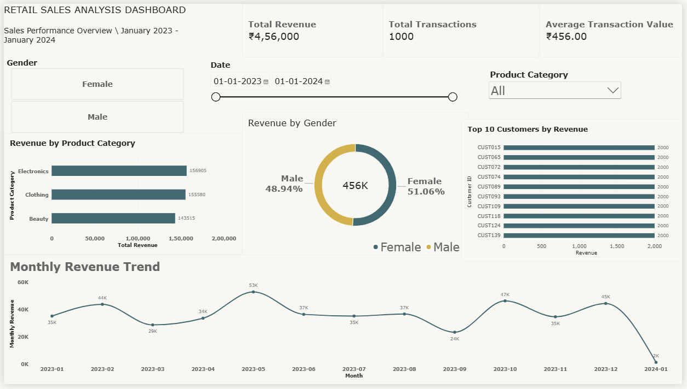

Retail Sales Analysis | Data Analytics Portfolio Project
Project Overview
This project focuses on analyzing retail sales data to identify revenue trends, understand customer purchasing behavior, and evaluate product category performance.
The project demonstrates an end-to-end data analytics workflow using Excel, SQL, Python, and Power BI, covering data inspection, cleaning, analysis, visualization, and business insights.
Dashboard Preview

Project Objectives
•	Analyze overall retail sales performance.
•	Calculate key business performance indicators (KPIs).
•	Identify top-performing product categories.
•	Understand sales distribution by gender.
•	Analyze monthly revenue trends.
•	Identify high-value customers.
•	Build an interactive Power BI dashboard.
Tools & Technologies
Tool	Purpose
Microsoft Excel	Data inspection and initial cleaning
SQL (SQLite)	Data querying and business analysis
Python	Data cleaning, analysis, and visualization
Pandas	Data manipulation and aggregation
Matplotlib	Data visualization
Power BI	Interactive dashboard development
VS Code	Development environment
Git & GitHub	Version control and project hosting
Dataset Description
The dataset contains 1,000 retail transaction records with the following columns:
Column	Description
Transaction ID	Unique transaction identifier
Date	Date of transaction
Customer ID	Customer identifier
Gender	Customer gender
Age	Customer age
Product Category	Category of purchased product
Quantity	Number of units purchased
Price per Unit	Price of one unit
Total Amount	Total transaction value
Dataset coverage: 2023–2024.
Project Workflow
1. Data Inspection and Cleaning – Excel
•	Inspected the dataset structure and column values.
•	Checked for missing values and duplicate records.
•	Verified transaction IDs and date values.
•	Checked the relationship between quantity, unit price, and total amount.
•	Prepared the dataset for analysis.
2. SQL Analysis – SQLite
Performed SQL queries to answer business questions, including:
•	What is the total revenue?
•	How many unique transactions were recorded?
•	What is the average transaction value?
•	Which product category generates the highest revenue?
•	How does revenue vary by gender?
•	What are the monthly revenue trends?
•	Who are the top customers by spending?
3. Python Analysis – Pandas and Matplotlib
•	Loaded and inspected the dataset using Pandas.
•	Cleaned text and converted data types.
•	Checked missing values and duplicate records.
•	Calculated business KPIs.
•	Used groupby() and aggregation functions for analysis.
•	Created visualizations to understand sales patterns.
4. Power BI Dashboard
Developed an interactive dashboard containing:
•	Total Revenue KPI
•	Total Transactions KPI
•	Average Transaction Value KPI
•	Revenue by Product Category
•	Revenue by Gender
•	Monthly Revenue Trend
•	Top 10 Customers
•	Interactive slicers for filtering the data
Key Performance Indicators (KPIs)
KPI	Result
Total Revenue	₹4,56,000
Total Transactions	1,000
Average Transaction Value	₹456
Total Records	1,000
Key Business Insights
1.	Revenue Performance: The dataset generated total revenue of ₹4,56,000 across 1,000 transactions.
2.	Category Performance: Clothing recorded 351 transactions, Electronics 342, and Beauty 307.
3.	Gender Analysis: Female customers accounted for approximately 51.06% of transactions in the dashboard analysis.
4.	Monthly Revenue: May 2023 was the highest-revenue full month, generating ₹53,150 from 105 transactions.
5.	Lowest Revenue Month: September 2023 recorded the lowest full-month revenue of ₹23,620 from 65 transactions.
6.	Customer Analysis: Customer-level spending analysis was used to identify the top 10 customers.
Note: January 2024 contains only two transactions, so comparisons involving that month should be interpreted cautiously.
Project Structure
Sales_Performance_Analysis/
│
├── charts/
│   ├── category_revenue.png
│   ├── gender_revenue.png
│   ├── monthly_revenue.png
│   └── top_customers.png
├── data/
│   ├── cleaned_sales.csv
│   └── retail_sales_cleaned.csv
├── database/
│   └── sales.db
├── python/
│   ├── import_data.py
│   └── sales_analysis.py
├── sql/
│   ├── 01_basic_analysis.sql
│   └── 02_business_analysis.sql
│
├── .gitignore
├── README.md
└── Retail_Sales_Analysis.pbix
The Power BI report is saved separately as Retail_Sales_Analysis.pbix 
How to Run This Project
1.	Clone or download this repository.
2.	Open the project folder in VS Code.
3.	Install Python if it is not already installed.
4.	Install the required libraries:
pip install pandas matplotlib openpyxl
5.	Run the Python analysis script from the project root:
python python/sales_analysis.py
6.	Open the SQL files using a SQLite-compatible editor.
7.	Open Retail_Sales_Analysis.pbix using Power BI Desktop, if included.
Skills Demonstrated
•	Data Cleaning and Preprocessing
•	Exploratory Data Analysis (EDA)
•	SQL Queries and Aggregations
•	Python Data Analysis
•	Data Visualization
•	KPI Development
•	Business Insights Generation
•	Power BI Dashboard Development
•	Git and GitHub Version Control
Conclusion
This project demonstrates how raw retail transaction data can be transformed into meaningful business insights using commonly used data analytics tools.
It helped develop practical skills in data preparation, querying, analysis, visualization, and dashboard development.

Project Type: Data Analytics Portfolio Project
Domain: Retail / Sales Analytics
Tools: Excel | SQL | Python | Power BI
